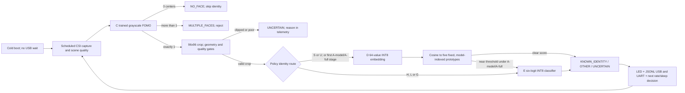

# Nicla wearable runtime v1

This is the maintained standalone entry point for the five-person study. The old `recognize.py`, `recognize_embedding.py`, and `recognize_controlled.py` files remain available for historical probes; deployment uses `firmware/boot.py` plus `firmware/main.py`, `identity_contracts.py`, `runtime_support.py`, `telemetry.py`, and the hash-bound v1 bundle.

## Pipeline



The detector decides whether a face-like region exists. The D embedding/gallery or E classifier assigns a roster ID. The E model executes only under H/L/G and when A-model/A-full escalates a D score near its threshold. Both models run on the same MCU. The default cache holds one model object and releases/collects it before loading another. A bounded two-model LRU is implemented for later on-device qualification, but is not enabled by this config.

The supported scope is one face in the 240x240 camera window. Zero detections produce `NO_FACE`; multiple detections produce `MULTIPLE_FACES`; a single clipped crop or quality failure produces `UNCERTAIN` with a reason. There is no calibrated physical distance range in this release.

## Frozen model contracts

| Stage | Selected artifact | Input | Output and decision |
|---|---|---|---|
| C detector | `detector_gray_fomo_int8.tflite`, SHA-256 `4a484c9b…e5195c` | 96x96 grayscale INT8; input scale 1/255, zero point -128; sourced from the exact 240x240 grayscale camera window | 12x12x2 INT8; scale 1/256, zero point -128; face channel uses strict `score > 0.7`; OpenMV FOMO center geometry; 96x96 crop rounds `floor(center - side/2 + 0.5)`, rejects outside crops without moving or padding |
| D compact route | `identity_embedding_a010_int8.tflite`, SHA-256 `0bf2bc5f…a9b0cd` | 96x96 grayscale INT8; scale 1/255, zero point -128 | 64 INT8 embedding values, dequantized once from the exported output scale/zero point, L2-normalized, compared with five fixed 64-value prototypes |
| E larger route | `identity_classifier_a025_int8.tflite`, SHA-256 `8be1d461…b9ca55` | 96x96 grayscale INT8; scale 1/255, zero point -128 | six INT8 **logits** in order `K01,K02,K03,K04,K05,OTHER`; dequantize once, apply one stable softmax, compare max known probability with the model-bound threshold |

Both identity routes are typed separately. The classifier rejects any label order other than `K01..K05,OTHER`; a six-value classifier tensor cannot be treated as an embedding. All model/config/gallery hashes, output quantization, thresholds, roster order, and model IDs are checked before use. Invalid metadata, nonfinite values, zero embeddings, bad hashes, and missing models fail closed.

The runtime follows OpenMV 5.0.1's model API: input/output metadata is a list with one entry per tensor (`'b'` means signed INT8 and `'B'` means unsigned INT8); with no postprocessor, `predict()` returns integer outputs dequantized to floats. Identity results therefore go straight into the typed decision functions and are not scaled a second time. The C detector's FOMO postprocessor receives raw quantized outputs and maps detections to the source ROI. See the official [model metadata](https://docs.openmv.io/v5.0.1/openmvcam/tutorial/ml/ml-module/loading-a-model.html), [predict pipeline](https://docs.openmv.io/v5.0.1/openmvcam/tutorial/ml/pipeline/anatomy-of-predict.html), [FOMO postprocessor](https://docs.openmv.io/v5.0.1/library/omv.ml.postprocessing.edgeimpulse.html), and [CSI API](https://docs.openmv.io/v5.0.1/library/omv.csi.html).

The D prototype digest in the saved D gallery receipt did not reproduce byte for byte when recalculated here, even though the selected train record IDs and deployed model hash match. F therefore regenerates prototypes from those same 15 frozen train records and refits only on the same `threshold_calibration` and `unknown_calibration` roles. The bundle records both digests and the refreshed threshold in `models/deployment-v1/embedding_gallery_calibration.json`. The held-out final role is not loaded. This is a reproducibility correction, not a new accuracy result.

## Policies

| ID | Capture | Identity | Adaptation/action |
|---|---:|---|---|
| H | 250 ms, QVGA | E each valid face | fixed high sampling |
| L | 2000 ms, QVGA | E each valid face | fixed low sampling |
| S | 250 ms, QVGA | D gallery | detector-triggered compact baseline |
| G | 250 ms, QVGA | E each valid face | detector-triggered larger baseline |
| A-sense | 250 ms moving; 1500 ms still | E | IMU motion adapts acquisition cadence and blocks identity inference while moving |
| A-model | 1000 ms, QVGA | D, then E only near the D threshold | model-only escalation |
| A-full | 250 ms moving; 1500 ms still, VGA sensor mode with the same centered 240x240 window | D, then E near threshold | motion gate, `2 of 3` same-ID confirmation, CSI sleep after idle, periodic stationary-scene checks |
| U | fixed 2000 ms, QVGA | D only | always capture, run C detector, stop at `NO_FACE`, reject multiple/clipped/low-quality crops, never load E, no temporal votes; invalid data can never create an identity |

The camera window remains 240x240 sensor pixels in QVGA and VGA modes. The `framerate()` action drops sensor frames; `CSI.sleep(True/False)` is separate physical camera sleep. Wake waits for exposure settling and the first frame must pass quality checks. Stationary sleep still wakes for periodic scene checks. Image brightness is reported in grayscale units, never as lux; the IMU only describes wearer/device movement.

The trained grayscale FOMO path is selected. A separately declared optional stock RGB FOMO path captures RGB565 and requires its own 96x96x3 INT8 interface and ROM model metadata. The stock path is not substituted into the grayscale C contract.

## Memory and lifecycle

- One camera framebuffer; detector and identity window is 240x240 grayscale (57,600 pixels), with one 96x96 grayscale crop (9,216 pixels).
- Default model cache limit is one. `ml.Model.ram`, Python heap before/after load, cold load time, warm hits, inference time, swap time, and `gc.collect()` time are emitted. `MemoryError` becomes an uncertain result and skips escalation.
- The D flatbuffer is 101,576 bytes; E is 327,072 bytes. E's host static tensor-liveness estimate was 75,280 bytes; it is not the Nicla arena measurement. The target's actual arena is emitted after `ml.Model` loads and still needs physical qualification.
- Fixed gallery has five normalized 64-value prototypes. Control line max is 192 bytes. USB and UART each have independent 8 KiB telemetry queues, records capped at 1,024 bytes, and bounded per-loop writes (512 bytes on the shared path/UART and 2,048 bytes on USB).
- No frame is written to flash and no per-frame state is persisted. The on-board release is immutable and selected through a tiny version pointer.

## Telemetry and control

Telemetry is UTF-8 JSONL with schema `nicla-face-telemetry-1`, `run_id`, monotonic `sequence`, `ticks_ms`, tick modulus, reset cause, firmware/config/schema hashes, and event/failure reason. Events include `boot`, `run_start`, `capture_start/end`, `detect_start/end`, `model_load/cache_hit/model_swap`, `identity_start`, `decision`, `gc_collect`, `camera_frame_rate`, `camera_sleep/wake`, `control_rx`, `control_input_error`, `control_input_status`, and `control_ack`. UART output is queued and flushed independently of USB connection state.

UART is configured as UART4, 115200 baud. OpenMV's documented starting pin map is TX on SDA/J2-1 and RX on SCL/J2-2; these pins share the board's I2C1 use. The current host did not have a 3.3V USB-to-TTL adapter, so the mapping and UART command path remain physically unverified. For an external adapter, cross TX/RX and share ground; leave adapter VCC disconnected. `pyb.USB_VCP` remains available for USB CDC.

Commands are one bounded JSON object per line:

```json
{"cmd":"identity"}
{"cmd":"config"}
{"cmd":"ping"}
{"cmd":"seed","seed_id":"H-20261030-01","host_marker":"2026-10-30T16:00:00Z"}
{"cmd":"start","policy_id":"G"}
{"cmd":"status"}
{"cmd":"trial","policy_id":"G","frames":10,"duration_ms":25000,"trial_id":"h-20261030T160000000000Z"}
{"cmd":"stop"}
```

`trial` is limited to 50 frames and 30 seconds. `trial_id` is optional; when present, retransmitting the same ID returns an ACK without restarting the trial. Repeating the same `seed_id` returns an ACK without duplicating the synchronization marker. Unsupported or invalid commands return `control_ack` with a reason; parser input is capped at 192 bytes. `host/nicla_protocol.py` is the Windows/macOS pyserial adapter. Example usage:

```powershell
python host/nicla_protocol.py --port COM5 identity
python host/nicla_protocol.py --port COM5 config
python host/nicla_protocol.py --port COM5 trial --policy G --frames 10 --duration-ms 25000
```

Illustrative JSONL control/telemetry excerpt (field values are examples; this is not a captured board session):

```text
host -> Nicla  {"cmd":"ping"}
Nicla -> host  {"schema_id":"nicla-face-telemetry-1","event":"control_ack","sequence":4,"command":"ping","control_status":"ok","pong":true}
host -> Nicla  {"cmd":"trial","policy_id":"G","frames":10,"duration_ms":25000}
Nicla -> host  {"schema_id":"nicla-face-telemetry-1","event":"control_ack","sequence":5,"command":"trial","control_status":"ok","accepted_frames":10,"deadline_ms":25000,"policy_id":"G"}
Nicla -> host  {"schema_id":"nicla-face-telemetry-1","event":"decision","sequence":9,"policy_id":"G","decision":{"status":"NO_FACE","identity_id":null,"reason_code":"no_face"}}
Nicla -> host  {"schema_id":"nicla-face-telemetry-1","event":"trial_finished","sequence":31,"reason_code":"frame_limit","frame_index":10}
```

## Build, deploy, and recover

Run from the `FaceRecognition` directory:

```sh
python3 tools/stage_firmware_artifacts.py
/path/to/python-with-tensorflow tools/build_fixed_gallery.py
/path/to/python-with-tensorflow tools/verify_firmware_host.py
python3 tools/deploy_nicla_runtime.py --port /dev/cu.usbmodemXXXX
python3 tools/restore_nicla_runtime.py --port /dev/cu.usbmodemXXXX --backup-dir ../work/project-finish-v4/deployments/backups/<stamp>
```

The serial installer reads back and backs up the prior startup and active release pointer; stages a content-addressed folder under `/flash/releases`; verifies every file SHA; sequentially opens C/D/E and constructs UART4 in a preflight; atomically renames the release; updates `/flash/face_runtime.current`; and installs `/flash/main.py` last. `tools/deploy_nicla_via_usb_storage.py` provides the mass-storage path for a live watchdog-fed runtime: it verifies all files before promotion, backs up startup and pointer locally, atomically replaces the active files, and installs startup last. This path does not replace physical model/UART preflight. The small boot loader starts the selected release without waiting for a host. Previous release folders remain available. `--stock-startup` restores the first `/flash/main.py.stock` backup. No Nicla firmware is flashed to a Nano.

For a serial install on macOS, first unmount the Nicla's OpenMV FAT volume without unplugging the cable. The serial installer refuses a mounted OpenMV disk. A mounted volume and a serial write can leave 2,048-byte files on the device even when the reported free space is ample. If existing model checksums fail, install a full release from verified local assets and leave `--reuse-models-from` unset.

For the close-range face-box experiment, rebuild the precompiled runtime and add `--detector-backend gray_haar_box` to `deploy_nicla_runtime.py`. The on-device 96 × 96 globally equalized Haar cascade locates a face box. The runtime pads the box, keeps the square inside the camera frame, and uses the original grayscale pixels for identity. The legacy FOMO detector remains the default deployment profile. The gallery remains the configured device roster; selecting a detector does not enroll anyone. [Live crop evidence and reproduction](../../work/project-research-v5/LIVE_CROP_2026-11-10.md).

`tools/run_h_smoke_queue.py --port COM5 --policy G` sends identity/config/ping/seed/status, runs a bounded trial, saves JSONL, and checks for lifecycle/decision events. The current Nicla direct trial completed ten G-policy frames, but the complete queue did not finish reliably because control ACK delivery was intermittent. Run the full queue over USB CDC and again over wired UART after the USB-to-TTL adapter and pin mapping are confirmed. See `work/project-finish-v4/handoffs/F/H_ACCEPTANCE_QUEUE.md` for current board evidence and follow-up steps.

## J1 Mac source extension (physical requalification pending)

The current source adds a distinct `T` simple scene-statistics trigger, `A-risk` risk-table escalation, and `A-cost` measured-cost-aware escalation. `T` captures at the configured low-rate cadence, checks grayscale mean/standard-deviation changes with hysteresis, and still forces detector fallback every two seconds. These scene statistics are not a person detector or lux measurement. A still wearer cannot establish that a person entered the scene; the periodic detector fallback remains mandatory.

`A-risk` and `A-cost` use the same D-to-E model route but consult `controller_calibration.risk_bins`. The calibration table is deliberately empty in this source because valid development encounter labels and measured I costs do not yet exist. With no matching table, neither policy escalates; `A-risk` reports an unavailable-risk reason and `A-cost` reports the measured-cost calibration failure. Populate the table only from encounter-level development data after I and J cost measurements, re-hash the runtime configuration, and repeat the board checks.

The runtime caps small-to-large escalation at six per rolling minute and suppresses any decision arriving after the configured five-second response deadline as `UNCERTAIN`. Camera wake failures use bounded 1, 2, 4, then 8 second retry delays while preserving a live control loop. `U` remains the fixed 2-second stage-cost control and explicitly bypasses scene/crop quality gates while preserving detector, multiple-face, and crop-boundary checks. `NO_FACE`, `OTHER`, and `UNCERTAIN` keep separate output semantics.

The control `start` command now accepts an explicit `measurement_stage_id` for I lifecycle captures: `idle`, `camera_capture_only`, `detector_only`, `identity_small_only`, `identity_large_only`, `cold_model_load`, `warm_inference`, `model_swap_and_gc`, and `full_pipeline`. Stage-only identity calls emit timing/metadata and always return `UNCERTAIN`; they do not create an identity decision. Camera-crop identity stages include upstream camera capture and C detector work in the measured window, so their board power includes those costs. This source has no serial preloaded-image fixture injection. Warm stages require the exact H-qualified runtime config to allow two resident models; the current config allows one, so the I runner records warm cells as unsupported under it.

These additions change the firmware source hash. Earlier F/H board checks belong to their recorded source hash and do not qualify this code. Sophia's separate USB board check is defined in `work/project-finish-v4/handoffs/J/NICLA_BOARD_CHECK.md`; no new physical test is claimed by this source note.

## Evidence boundary

Host checks run the exact staged C/D/E TFLite files and actual C fixture bytes. All 13 host C raw-input and raw-output fixtures match their frozen bytes; the host detector resize helper matches all 13 fixtures. Ten seeded host blocks exercised actual D/E model outputs (six unique crops sampled across the ten seeds), manual dequantization, typed decisions and 14 injected fault cases. These host results do not establish Nicla/OpenMV camera or model parity.

The board is now running OpenMV 5.0.1 on `/dev/cu.usbmodem3270395F35322`, release `face-v1-a13bbcac1ccd-usb`. The 14-file release and startup/pointer were read back and verified. A no-command startup preview observed detector frames 8–10 after reset; a direct 10-frame G trial completed with `NO_FACE` on all ten detector results. Board exact-input parity matched the 13 camera windows, 13 resize outputs, and 13 INT8 inputs, but raw detector outputs differed on all fixtures (1,605 of 3,744 values; maximum signed INT8 delta 15); FOMO rectangles matched on 9/13. The full host queue obtained identity/config/ping ACKs in one run but timed out at seed; subsequent control ACKs were intermittent. No USB-to-TTL adapter was observed, so UART is untested. The no-command preview kept USB physically attached and is not a cable-disconnected test. See the [device record](../../work/project-finish-v4/reports/F/device_discovery.json), [board parity transcript](../../work/project-finish-v4/reports/F/nicla_c_exact_parity_pillow_fix4.jsonl), [bounded trial](../../work/project-finish-v4/reports/F/nicla_bounded_trial_direct.jsonl), and [H queue](../../work/project-finish-v4/handoffs/F/H_ACCEPTANCE_QUEUE.md). D/E host performance is a limited public-image baseline and is not evidence of reliable real-person identity recognition.
