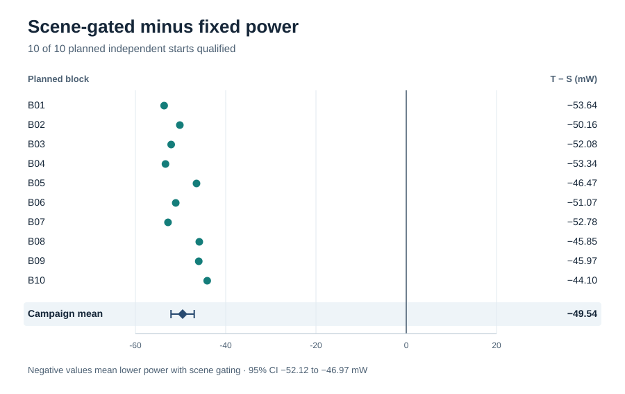
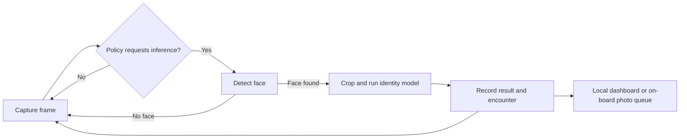

# Scene-gated face detection on a wearable microcontroller

**A paired power and latency study on the Arduino Nicla Vision**

Omri Steinberg-Tatman and Sophia Yuan · UCLA Embedded Systems · Fall 2026

[Paper](https://drive.google.com/file/d/1eikXZGxlXDb9nLYPIZaUHmPwaW2ffYkS/view) · [Presentation](https://docs.google.com/presentation/d/1TM9RoEXqlNgcfl5lDlVyWf49Zhnpr5LPnCpedgkzBws/edit) · [Quick start](#quick-start) · [Training](TRAINING.md) · [Reproduce the measurements](evidence/README.md)

Wearable cameras spend energy processing many nearly identical frames. We built a camera pipeline that uses scene changes to decide when to run face detection and downstream inference. The Nicla performs inference on the board, while a local dashboard displays the camera stream, frame-linked results, and saved encounters.

Across ten paired runs on the same board and video workload, scene gating reduced mean input power by **7.28%**, with the same **30/40 matched face episodes**. The tradeoff was a longer delay before the first matched face.

## Results

The experiment compared four workloads on a repeated 29-second clip. Each accepted block began with a separate Nicla power cycle.

| Workload | Mean input power | Matched face episodes | Median time to first match¹ |
| --- | ---: | ---: | ---: |
| Camera capture only | 608.72 mW | — | — |
| Detector only | 670.17 mW | — | — |
| Fixed full pipeline | 680.29 mW | 30/40 | 0.65 s |
| Scene-gated full pipeline | 630.75 mW | 30/40 | 1.38 s |

¹ Among matched episodes. Both full pipelines missed the far-outdoor segment in every block.

The paired mean saving was **49.54 mW**, with a 95% t interval of **46.97–52.12 mW**. Both modes used the same awake camera, configured 250 ms capture interval, Haar face detector, and small INT8 identity model. Scene gating skipped detector and downstream work during quiet periods, with periodic checks. The dashboard's fast live policy is a separate configuration.

<details>
<summary>View the ten paired measurements</summary>



[Paired CSV](work/project-research-v5/final-readiness-2026-11-12/r19-paired-power.csv) · [Methods and limitations](work/project-research-v5/final-readiness-2026-11-12/FINAL_READINESS.md) · [Raw-data replay](evidence/README.md)

</details>

## Pipeline



The dashboard shows the live image, detector box, crop, identity-stage output, timing, and errors for the same device frame. It supports video with inference and one saved photo per confirmed encounter. Saved photos can be browsed by **Person 1–5** and **Other**, with explicit manual assignments. On-board photos can be imported after reconnecting over USB.

The current **R19** release executes the identity model with automatic known-person acceptance disabled. Reliable recognition across camera conditions remains an open result. Manual gallery assignments organize photos and have their own labels. The measured power result evaluates the adaptive face-detection fallback in the [original proposal](proposal-final.md).

## Quick start

Use Python **3.12** for the camera application. Training has a separate environment described in [TRAINING.md](TRAINING.md).

```sh
git clone https://github.com/sophiayuanproj/FaceRecognition.git
cd FaceRecognition
```

The cloned repository contains an inner `FaceRecognition/` application folder. Run the following commands from the repository root.

### macOS · Intel and Apple Silicon

```sh
sh SETUP_MAC.command
sh FaceRecognition/bin/nicla-control-center --open-browser
```

### Windows · 64-bit Python 3.12 with the Python Launcher

```powershell
.\SETUP_WINDOWS.cmd
.\FaceRecognition\tools\windows_v5\Start-NiclaControlCenter.cmd
```

Open the exact localhost URL printed by the launcher. Connect the Nicla with a USB data cable, select **Connect / claim control**, and choose **Start processing**. Close other serial clients before connecting. FNIRSI meter support is available on Windows. [Operator guide](FaceRecognition/control_center/README.md)

An existing R19 board can connect directly. For a replacement board or firmware recovery, follow [DEPLOYMENT.md](DEPLOYMENT.md). To update an existing clone, save your local changes and run `git pull --ff-only`.

## Encounters and offline capture

Select **Start saving** to keep encounter photos on the computer. A new encounter can be saved after the face leaves the frame for a few seconds. Open a saved photo to review it or assign a person. The gallery retains up to **100 photos or 8 MiB**, with persistent encounter counts.

For offline capture, stop processing and select **Arm offline capture** before moving the cable to a power bank. After reconnecting to the computer, stop processing and select **Import photos**. **View imported photos** filters the gallery to the on-board captures. Repeating an import skips duplicates. The board retains up to **24 photos or 96 KiB**.

A screen rehearsal saved four photos across four separated encounters, with each JPEG verified against its device-frame hash. A continuous face hold and blank intervals added no duplicates. On-board recording and re-import passed with USB power and a closed host serial connection. A physical power-bank boot still needs a rehearsal.

## Repository guide

| Location | Purpose |
| --- | --- |
| [FaceRecognition/control_center](FaceRecognition/control_center) | Local camera dashboard and Windows meter panel |
| [FaceRecognition/host](FaceRecognition/host) | Serial protocol, recordings, encounter storage, and import |
| [FaceRecognition/firmware](FaceRecognition/firmware) | Nicla source, compiled modules, and configuration |
| [FaceRecognition/models/deployment-v1](FaceRecognition/models/deployment-v1) | Complete deployed models, labels, and gallery |
| [detector](detector/README.md) | FOMO training, annotation, export, and evaluation |
| [workflow](workflow) | Data restoration and ten-seed model campaigns |
| [work/model-training](work/model-training/README.md) | Earlier embedding and compression experiments |
| [work/project-finish-v4](work/project-finish-v4/README.md) | Frozen splits, experiment definitions, and model comparisons |
| [bench](bench) | Measured release fingerprints and installation records |
| [evidence](evidence/README.md) | Download and replay the raw power measurements |

[Training instructions](TRAINING.md) · [Dataset provenance](DATA.md) · [Windows power procedure](WINDOWS_VIDEO_POWER_BENCH.md) · [Development notes](docs/development/README.md)

Saved fitted checkpoints and the raw power study are attached to the [research assets release](https://github.com/sophiayuanproj/FaceRecognition/releases/tag/research-assets-2026-11-22). The normal checkout includes the complete deployed models and compiled firmware. Source images, camera recordings, local databases, and environments stay in ignored local directories.

## Verify the checkout

The portable checks verify model sizes and hashes, compiled-firmware consistency, host behavior, and dashboard controls. JavaScript tests require Node.js 18 or newer.

```sh
# macOS
FaceRecognition/.venv-nicla/bin/python -B tools/check_repository.py
```

```powershell
# Windows
.\FaceRecognition\.venv-nicla-windows\Scripts\python.exe -B tools\check_repository.py
```

Mac launcher checks run on POSIX systems. Optional host-reference tests use the separate research environment and its recorded assets. See [TRAINING.md](TRAINING.md) for those dependencies.
